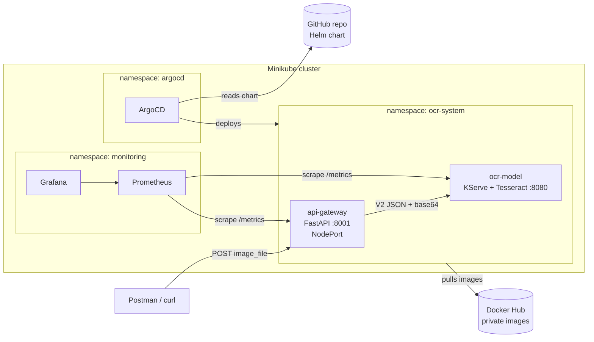
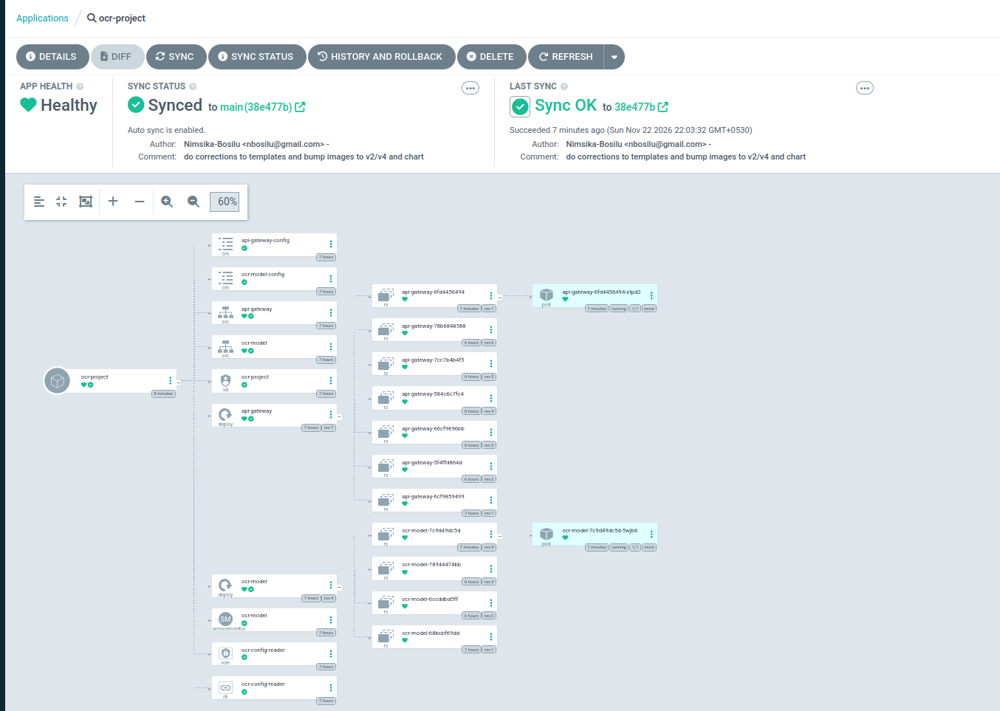
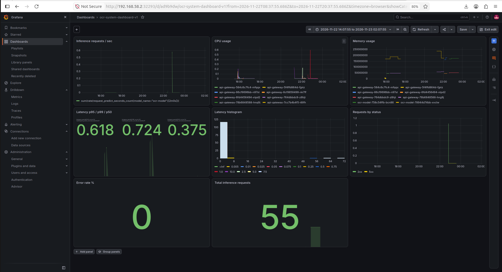
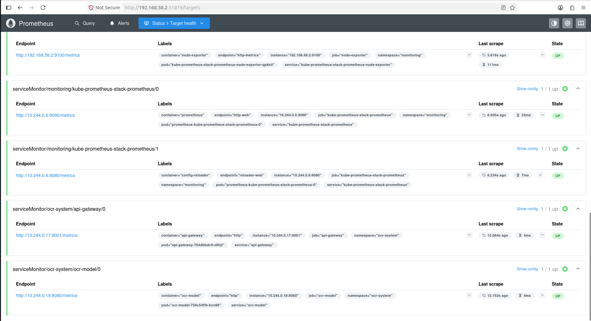

# OCR Inference System on Kubernetes

A simple two-service OCR (text from image) system.
It runs on a local Minikube cluster and uses Docker, Helm, ArgoCD, Prometheus and Grafana.

- **ocr-model**: a KServe model server. It reads text from an image using Tesseract.
- **api-gateway**: a FastAPI app. It takes an image upload and sends it to the model.

---

## 1. Architecture



## ArgoCD Application Dashboard



## Grafana Monitoring



## prometheus endpoints for pods



**How a request works**

1. The user sends an image to `POST /gateway/ocr` (form-data key: `image_file`).
2. The gateway reads the image and converts it to base64.
3. The gateway sends a KServe V2 inference request to the model:
   `http://ocr-model.ocr-system.svc.cluster.local:8080/v2/models/ocr-model/infer`
4. The model decodes the image and runs Tesseract OCR.
5. The model returns the text. The gateway sends it back to the user.

---

## 2. Repository structure

```
ocr-project/
├── services/
│   ├── ocr-model/          model.py, Dockerfile, pyproject.toml, poetry.lock
│   └── api-gateway/        api-gateway.py, Dockerfile, pyproject.toml, poetry.lock
├── charts/ocr-project/     Helm chart (both services in one chart)
├── argocd/                 AppProject, Application, ApplicationSet
├── infra/helm-values/      Values for kube-prometheus-stack and ArgoCD
├── scripts/                docker-build-test.sh, infra-setup.sh
├── dashboards/             Grafana dashboard JSON
├── tests/                  Test images (test.png, test.jpeg)
├── docker-compose.yml      Build and run both images locally
└── generate_ocr_traffic.sh Sends test requests to the cluster
```

---

## 3. Tools used

- Ubuntu (laptop)
- Python 3.11 and Poetry
- Tesseract OCR
- Docker
- Minikube (Docker driver)
- kubectl
- Helm v3
- ArgoCD, Prometheus and Grafana (installed with public Helm charts)
- Postman

---

## 4. Task 1 – Run locally

1. Install Tesseract:
   ```bash
   sudo apt-get install -y tesseract-ocr
   ```
2. Start the model (terminal 1):
   ```bash
   cd services/ocr-model
   poetry install --no-root
   poetry run python model.py
   ```
3. Start the gateway (terminal 2):
   ```bash
   cd services/api-gateway
   poetry install --no-root
   poetry run python api-gateway.py
   ```
4. Test with Postman:
   - Method: `POST`
   - URL: `http://localhost:8001/gateway/ocr`
   - Body: `form-data`, key `image_file`, type `File`, choose an image.

**Notes**

- `--no-root` is used because the project is not a Python package. Poetry only installs the dependencies.
- The model has health URLs: `/v2/health/live` and `/v2/health/ready`.
- The model shows Prometheus metrics at `http://localhost:8080/metrics`.

---

## 5. Task 2 – Containerization

### Images

Both images are in **one private Docker Hub repository** (the free plan gives one private repo).
The tag shows which service it is:

- `nimsikapickme/ocr-project:ocr-model-v2`
- `nimsikapickme/ocr-project:api-gateway-v4`

### Build, test and push

```bash
bash scripts/docker-build-test.sh
```

This script:

1. Builds both images with `docker compose build`.
2. Starts both containers with `docker compose up -d`.
3. Waits 15 seconds for the services to start.
4. Stops the containers with `docker compose down`.
5. Pushes both images to Docker Hub with `docker compose push`.

`docker-compose.yml` has both `build` and `image` for each service, so the built image gets the Docker Hub name.

### Base image choice

- `python:3.11-slim` is used for both images.
- It is the official Python image and is small (about 50 MB).
- Python 3.11 matches the project requirement (`>=3.11,<3.13`).
- The full `python:3.11` image is about 1 GB. It has tools we do not need.
- `alpine` was not used. Packages like numpy and grpcio need to be compiled on Alpine, so the build is slower.

### Security

- Containers run as a **non-root user** (`appuser`, UID `10001`).
  - Dockerfile: `RUN useradd --uid 10001 appuser` and `USER 10001`.
  - Kubernetes: `runAsNonRoot: true` and `runAsUser: 10001`.
- Images are stored in a **private** repository.
- Kubernetes pulls the images with an image pull secret (`dockerhub-creds`).
- No passwords or tokens are stored in the images or in Git.
- The pod does not mount a Kubernetes API token (`automountServiceAccountToken: false`), because the apps do not use the Kubernetes API.

### Build optimization

- **Layer order**: `pyproject.toml` and `poetry.lock` are copied before the code. If only the code changes, Docker uses the cached dependency layer, so the build is fast.
- `apt-get install --no-install-recommends`: only the needed packages are installed.
- `rm -rf /var/lib/apt/lists/*`: removes the apt package list after install.
- `pip install --no-cache-dir`: pip does not keep a download cache in the image.
- `poetry install --only main`: no development packages.
- `poetry config virtualenvs.create false`: packages go into the image's Python directly. A container is already isolated, so a virtualenv is not needed.
- `.dockerignore` skips `.venv`, `__pycache__` and `poetry.toml`. This keeps the build context small.
- The gateway image does not install Tesseract. Only the model needs it.

---

## 6. Task 3 – Infrastructure

### Setup

```bash
bash scripts/infra-setup.sh
```

This script:

1. Starts Minikube: profile `ocr-devops`, Docker driver, 4 CPUs, 8 GB RAM.
2. Adds the Helm repos `prometheus-community` and `argo`.
3. Installs **kube-prometheus-stack** (Prometheus + Grafana) in namespace `monitoring`.
4. Installs **ArgoCD** in namespace `argocd`.
5. Creates the namespace `ocr-system` for the app.

`helm upgrade --install` is used, so the script can be run again safely.

### kube-prometheus-stack values (`infra/helm-values/kube-prometheus-stack-values.yaml`)

- `alertmanager.enabled: false` – alerts are not needed. Saves memory.
- `kubeEtcd`, `kubeControllerManager`, `kubeScheduler`, `kubeProxy` disabled – Minikube does not expose these, so they would always show as DOWN.
- `retention: 2d` – keeps only 2 days of metrics to save disk.
- `serviceMonitorSelectorNilUsesHelmValues: false` – lets Prometheus find the ServiceMonitors in our chart.
- Prometheus resources: request 100m CPU / 400Mi memory, limit 1Gi memory.
- `grafana.sidecar.dashboards` – Grafana loads any ConfigMap with the label `grafana_dashboard: "1"` from all namespaces.

### ArgoCD values (`infra/helm-values/argocd-values.yaml`)

- `server.insecure: true` – the UI uses plain HTTP through port-forward (no TLS certificate locally).
- `dex.enabled: false` – no SSO login is needed.
- `notifications.enabled: false` – no Slack or email alerts are needed.
- Small resource limits for the controller and repo server to fit the laptop.

---

## 7. Task 4 – Helm chart

One chart (`charts/ocr-project`) deploys both services. The two services are always released together, so one chart keeps the setup simple.

### Resources in the chart

| File | What it creates |
|---|---|
| `model-deployment.yaml` | Deployment for the model, with liveness and readiness probes |
| `model-service.yaml` | ClusterIP Service on port 8080 (only inside the cluster) |
| `model-configmap.yaml` | `MODEL_NAME` setting |
| `gateway-deployment.yaml` | Deployment for the gateway, with TCP probes |
| `gateway-service.yaml` | NodePort Service on port 8001 (reachable from the laptop) |
| `gateway-configmap.yaml` | `KSERVE_URL` setting |
| `serviceaccount.yaml` | ServiceAccount for both pods |
| `rbac.yaml` | Role and RoleBinding: read-only access to the two ConfigMaps only |
| `model-servicemonitor.yaml` | Tells Prometheus to scrape the model `/metrics` |
| `gateway-servicemonitor.yaml` | Tells Prometheus to scrape the gateway `/metrics` |
| `grafana-dashboard.yaml` | ConfigMap with the Grafana dashboard |

### Notes

- The gateway uses **TCP probes**. The gateway has no health URL, so Kubernetes checks that port 8001 is open.
- Resource requests and limits are set for both pods.

### Create the image pull secret

This is done by hand so the token is never saved in Git:

```bash
kubectl -n ocr-system create secret docker-registry dockerhub-creds \
  --docker-server=https://index.docker.io/v1/ \
  --docker-username=nimsikapickme \
  --docker-password=<docker-hub-token>
```

### Push the chart to Docker Hub

```bash
helm lint charts/ocr-project
helm package charts/ocr-project
helm registry login registry-1.docker.io -u nimsikapickme
helm push ocr-project-0.2.0.tgz oci://registry-1.docker.io/nimsikapickme
```

---

## 8. Task 5 – GitOps with ArgoCD

ArgoCD reads the Helm chart from this **GitHub repository**. When a change is pushed to `main`, ArgoCD deploys it.

### Files

- `argocd/appproject.yaml` – project `ocr-inference`. It only allows this GitHub repo and only the `ocr-system` namespace.
- `argocd/application.yaml` – one Application for `charts/ocr-project`.
- `argocd/applicationset.yaml` – a Git directory generator. It creates one Application for each folder in `charts/`.

Use the Application **or** the ApplicationSet, not both. They create an app with the same name (`ocr-project`).

### Sync settings

- `automated` – ArgoCD syncs changes from Git by itself.
- `prune: true` – resources removed from the chart are removed from the cluster.
- `selfHeal: true` – manual changes in the cluster are reverted to match Git.
- Finalizer – when the app is deleted, its resources are also deleted.

### Deploy

1. Open the ArgoCD UI:
   ```bash
   kubectl -n argocd get secret argocd-initial-admin-secret -o jsonpath='{.data.password}' | base64 -d; echo
   kubectl -n argocd port-forward svc/argocd-server 8443:80
   ```
   Go to `http://localhost:8443` and log in as `admin`.
2. If the GitHub repo is private, add it in **Settings → Repositories** with a read-only GitHub token.
3. Apply the ArgoCD objects:
   ```bash
   kubectl apply -f argocd/appproject.yaml
   kubectl apply -f argocd/applicationset.yaml
   ```
   (Or use `argocd/application.yaml` instead of the ApplicationSet.)
4. Check:
   ```bash
   kubectl -n argocd get applications
   kubectl -n ocr-system get pods,svc
   ```
   The app should be **Synced** and **Healthy**.

---

## 9. Testing in the cluster

The gateway is exposed with a **NodePort**, so no port-forward is needed.

1. Find the URL:
   ```bash
   minikube ip -p ocr-devops
   kubectl -n ocr-system get svc api-gateway
   ```
   The NodePort is the number after `8001:` (for example `8001:31234/TCP`).
2. Test with curl:
   ```bash
   curl -X POST http://<minikube-ip>:<node-port>/gateway/ocr -F "image_file=@tests/test.png"
   ```
3. Or use Postman with the same URL.

### Generate traffic for the dashboard

```bash
bash generate_ocr_traffic.sh
```

It sends 50 valid images and 5 invalid files. The invalid files create errors, so the error rate panel has data.

---

## 10. Task 6 – Monitoring

### Metrics

- **Model**: KServe built-in metrics on port 8080 at `/metrics`.
  - `request_predict_seconds` – a histogram of inference time.
  - `_count` gives the number of requests, `_bucket` gives the latency distribution.
- **Gateway**: `prometheus-fastapi-instrumentator` adds `/metrics` on port 8001.
  - `http_requests_total` – requests by status (`2xx`, `4xx`, `5xx`). KServe has no status code metric, so this is used for the error rate.
- **Resources**: CPU and memory come from cAdvisor (part of kube-prometheus-stack).

### Scraping

- Two **ServiceMonitors** (model and gateway) tell Prometheus what to scrape, every 15 seconds.
- Check in Prometheus: **Status → Target health**. Both targets should be **UP**.
  ```bash
  kubectl -n monitoring port-forward svc/kube-prometheus-stack-prometheus 9090:9090
  ```

### Grafana dashboard

```bash
kubectl -n monitoring port-forward svc/kube-prometheus-stack-grafana 3000:80
```

Go to `http://localhost:3000` (user `admin`, password `admin123`).

| Panel | PromQL |
|---|---|
| Total inference requests | `sum(request_predict_seconds_count{model_name="ocr-model"})` |
| Inference requests / sec | `sum(rate(request_predict_seconds_count{model_name="ocr-model"}[1m]))` |
| CPU usage | `sum by (pod) (rate(container_cpu_usage_seconds_total{namespace="ocr-system", container!=""}[2m]))` |
| Memory usage | `sum by (pod) (container_memory_working_set_bytes{namespace="ocr-system", container!=""})` |
| Latency p50 / p95 / p99 | `histogram_quantile(0.95, sum by (le) (rate(request_predict_seconds_bucket[5m])))` |
| Latency histogram | `sum by (le) (increase(request_predict_seconds_bucket[$__rate_interval]))` |
| Requests by status | `sum by (status) (rate(http_requests_total{handler="/gateway/ocr"}[1m]))` |
| Error rate % | `100 * sum(rate(http_requests_total{handler="/gateway/ocr", status=~"4xx\|5xx"}[5m])) / sum(rate(http_requests_total{handler="/gateway/ocr"}[5m]))` |

These panels cover the assignment examples:

- Total inference requests → first two panels.
- Resource utilization → CPU and memory.
- Inference latency histogram → latency panels.
- Error rate / request status → last two panels.

The dashboard JSON is stored in Git and deployed by the chart as a ConfigMap with the label `grafana_dashboard: "1"`. Grafana loads it automatically.

---

## 11. Design decisions

- **One Helm chart for both services** – they are always deployed together.
- **NodePort for the gateway** – the gateway can be reached from the laptop without port-forward. The model stays ClusterIP (internal only).
- **ArgoCD reads from GitHub** – Git is the source of truth (GitOps). A `git push` updates the cluster.
- **One private Docker Hub repo with two tags** – the free plan allows one private repo.
- **KServe model server as a normal Deployment** – the full KServe operator needs Knative and Istio, which is too heavy for a laptop.
- **Gateway metrics library** – needed for error rate, because KServe has no status code metric.

---

## 12. Known limitations

- The gateway uses a fixed `KSERVE_URL` (the Kubernetes service address) in the code. It works in the cluster. In Docker Compose the gateway cannot reach the model with this URL, so the local compose test only checks that the containers start.
- The Grafana admin password is in the values file. This is fine for a local demo. In production, use a Kubernetes Secret.
- Prometheus and Grafana have no persistent storage. Metrics are lost if the pod restarts.

---

## 13. Cleanup

```bash
kubectl delete -f argocd/applicationset.yaml
minikube delete -p ocr-devops
```
